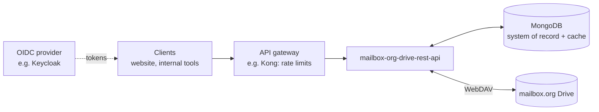

# mailbox-org-drive-rest-api

A self-hostable REST API that puts a **mailbox.org Drive** (or another WebDAV store) behind clean JSON endpoints:

- **Collections** — create, read, update and delete JSON records, validated against a JSON Schema, stored in MongoDB and mirrored to `.xlsx` workbooks on the Drive so people can open them in a spreadsheet.
- **Sheets** — expose an `.xlsx` file kept on the Drive as read-only JSON (for example a list of articles that staff edit by hand).
- **Documents** — serve `.docx` files from the Drive as Markdown.
- **Files** — list and download files from allow-listed Drive folders.
- *Later:* an S3-compatible object API for larger files.

> **Unofficial project.** Not affiliated with, endorsed by or supported by mailbox.org / Heinlein Support GmbH or Open-Xchange. "mailbox.org" is used only to describe compatibility.

> **Status: pre-alpha / planning.** Nothing here is usable yet. Everything below describes the intended design and may change. Planning artefacts live in [`.planning/`](.planning/).

---

## Why

Small organisations that already pay for a privacy-respecting mailbox.org account have Drive storage that staff use every day. This project lets a website or internal tool use that same storage:

- form submissions land in a spreadsheet staff can open, without anyone running a CMS;
- content that staff edit in Drive (spreadsheets, Word documents) can be published through an API;
- data stays with the organisation's existing provider.

The API is **generic**: nothing in this repository is specific to any one organisation. Each deployment describes its own collections, folders and access rules in a config file.

## Architecture



| Data | Source of truth | Direction |
|------|-----------------|-----------|
| Collection records (e.g. form responses) | MongoDB | API writes to MongoDB, then a single background writer regenerates the `.xlsx` mirror on the Drive. The mirror is **read-only for people**. |
| Sheets (e.g. a newsfeed index) | Drive `.xlsx` | Staff edit on the Drive; the API reads and caches it in MongoDB, refreshing when the file's ETag changes. |
| Documents (`.docx`) | Drive | Staff edit on the Drive; the API converts to Markdown on request and caches the result per file version. |
| Files | Drive | Read-only passthrough from allow-listed folders. |

Why MongoDB in front of the Drive: WebDAV has no transactions, so two writers updating one workbook can silently lose a record, and reading the Drive on every request is slow. MongoDB keeps writes safe and reads fast; the Drive stays the place people work.

## Concepts (planned)

- **Mount** — a named, allow-listed folder on the Drive, with `read` or `read-write` mode. The API can never reach outside its mounts.
- **Collection** — a named set of JSON records with a JSON Schema, an access policy and an optional `.xlsx` mirror on a mount.
- **Sheet** — a named `.xlsx` file (and worksheet) on a mount, exposed as JSON rows.
- **Access policy** — per collection and per operation: `anonymous`, `apiKey` or `oidc` (OIDC arrives in a later milestone).

### Example configuration (illustrative only)

```yaml
storage:
  webdav:
    url: https://dav.mailbox.org/servlet/webdav.infostore/
    username: ${WEBDAV_USERNAME}
    password: ${WEBDAV_APP_PASSWORD}

mounts:
  forms:   { path: "/Userstore/Example Service/forms",   mode: read-write }
  content: { path: "/Userstore/Example Service/content", mode: read }

collections:
  contact:
    schema: ./schemas/contact.schema.json
    access: { create: anonymous, read: apiKey, update: apiKey, delete: apiKey }
    mirror: { mount: forms, path: contact/responses.xlsx }

sheets:
  articles: { mount: content, path: articles.xlsx, worksheet: Articles }
```

### Endpoint sketch (planned, v1)

```
GET    /health
POST   /v1/collections/{collection}/records
GET    /v1/collections/{collection}/records
GET    /v1/collections/{collection}/records/{id}
PUT    /v1/collections/{collection}/records/{id}
PATCH  /v1/collections/{collection}/records/{id}
DELETE /v1/collections/{collection}/records/{id}
GET    /v1/sheets/{sheet}
GET    /v1/documents/{mount}/{path}.md
GET    /v1/files/{mount}/{path}
```

An OpenAPI description will be generated from the code and served at `/docs`.

## Security model

- **Use a dedicated Drive account for the API.** A WebDAV app password unlocks that account's whole Drive, so the API should run as its own account. People share only the folders it needs into that account. Sensitive material never lives in it.
- **Mounts are allow-lists**; paths are normalised and checked to block path traversal.
- **Anonymous endpoints** (e.g. public form submission) rely on schema validation, payload size limits and rate limiting at the gateway, optionally with a privacy-friendly CAPTCHA.
- **Secrets** come from environment variables or a secret store, never from the repository.
- **Personal data:** collection records may be personal data under the GDPR. Deployers are responsible for a lawful basis, retention and a data processing agreement with their storage provider (for mailbox.org, Heinlein Support GmbH offers one under Art. 28 GDPR).

### GDPR erasure (planned)

Overwriting a file on the Drive keeps its old versions, and deleted files go to the Drive trash. So an erasure is **not** simply "delete the record and regenerate the spreadsheet". The planned procedure:

1. Hard-delete the record in MongoDB.
2. **Delete** the `.xlsx` mirror (never overwrite it).
3. Purge it from the trash and remove its old versions. This probably uses the Open-Xchange HTTP API, because plain WebDAV may not reach the trash; otherwise it becomes a documented manual step.
4. Regenerate a fresh mirror with no version history.
5. Record the erased ID so the erasure is applied again if a database backup is restored.

Copies people have downloaded, and database backups, are outside the API's reach and belong in the deployer's own procedures.

## Tech stack (planned)

Node.js (LTS) · TypeScript · Fastify · JSON Schema (Ajv/TypeBox) · MongoDB · `webdav` client · `exceljs` · `mammoth` + `turndown` (`.docx` → HTML → Markdown) · Vitest · Docker Compose for local development (MongoDB plus a local WebDAV server, so tests never touch a real Drive).

## Roadmap

1. **Foundation** — service skeleton, config loading, WebDAV storage adapter, MongoDB, health check, CI, local dev stack.
2. **Collections** — JSON CRUD with schema validation, access policies (anonymous / API key), `.xlsx` mirror worker, reference gateway config with rate limits.
3. **Read-only content** — sheets as JSON, file listing and download, `.docx` → Markdown, caching keyed on ETags.
4. **OIDC and erasure** — validate tokens from an OIDC provider such as Keycloak; role-based access per collection; a GDPR erasure endpoint.
5. **Object storage** — an S3-compatible API for larger files (evaluate an `rclone serve s3` sidecar against a native subset).

## Compatibility and provider notes

The Drive adapter targets the WebDAV endpoint of mailbox.org Drive, which is built on Open-Xchange App Suite. It should work with other WebDAV servers, but only mailbox.org is a target for testing.

Things to know about mailbox.org as a backend (as of November 2026):

- **No published WebDAV rate limits**, and no official support for third-party integrations. The client is deliberately gentle: few requests in flight at once, exponential backoff on `429`/`503`, and reads served from cache rather than from the Drive.
- **No webhooks.** Changes on the Drive are detected by checking ETags on a configurable interval.
- **The terms of service** say nothing about automated WebDAV access. They do let the provider end a contract on two weeks' notice. Because MongoDB is the system of record and storage sits behind an adapter interface, a deployment can move to another backend.
- **WebDAV credentials:** if two-factor authentication is on, use an application password.

## Contributing

Not open for contributions yet. Issues and design feedback are welcome once the first milestone is published.

**Never commit real personal data, credentials or production config.** Use the synthetic fixtures in `test/fixtures/`.

## Licence

Licensed under the [European Union Public Licence v1.2](LICENSE) (EUPL-1.2).
